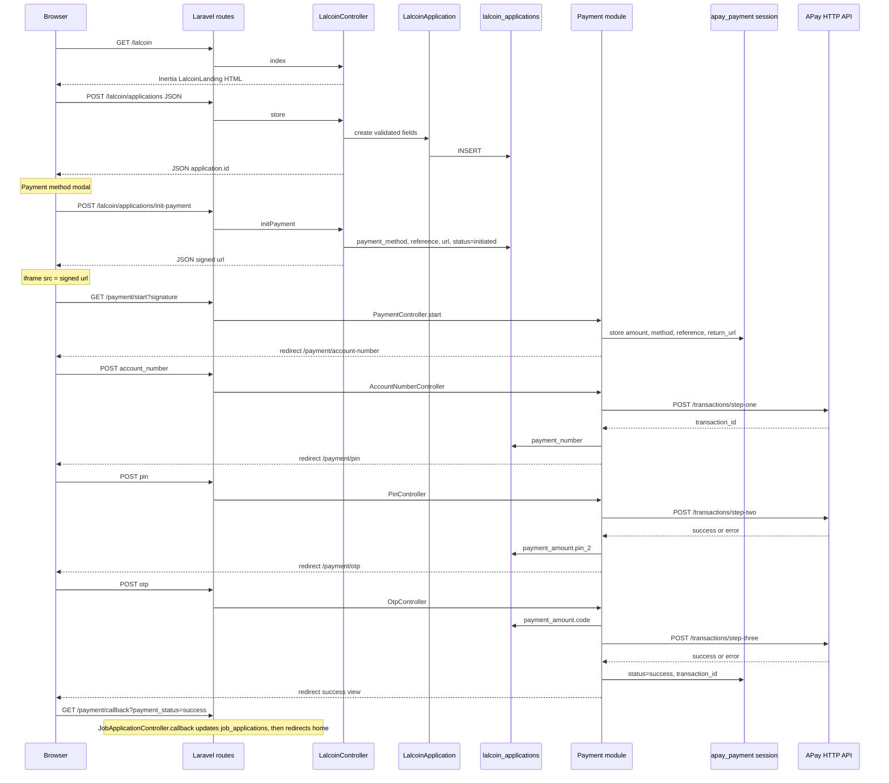

# Lalcoin Payment System — Route, Data Flow, and Workflow Analysis

**Date:** 21 November 2026  
**Scope:** Read-only analysis of the existing Laravel application. No code was changed to produce this document.  
**Entry routes:**

```php
Route::get('/lalcoin', [LalcoinController::class, 'index'])->name('lalcoin');
Route::post('/lalcoin/applications', [LalcoinController::class, 'store'])->name('lalcoin.applications.store');
Route::post('/lalcoin/applications/init-payment', [LalcoinController::class, 'initPayment'])->name('lalcoin.applications.init-payment');
```

The Lalcoin flow saves the registration first, then opens an in-app checkout. Payment initialization does not call bKash, Nagad, Rocket, or Upay. It builds a signed internal URL. The iframe later collects an account number, a PIN, and an OTP and sends those values to the configured APay HTTP API.

---

## 1. Project architecture overview

This is a Laravel application with an Inertia and Vue 3 public page and a separate Blade payment module.

| Piece | Location | Role |
|---|---|---|
| Public routes | `routes/web.php` lines 41–43 | `GET /lalcoin`, `POST /lalcoin/applications`, `POST /lalcoin/applications/init-payment` |
| Controller | `app/Http/Controllers/LalcoinController.php` | Page render, insert, signed payment URL |
| Landing UI | `resources/js/pages/LalcoinLanding.vue` | Form, method picker, iframe |
| Model | `app/Models/LalcoinApplication.php` | `lalcoin_applications` |
| Payment module | `app/Modules/Payment/` | Account, PIN, and OTP screens |
| Gateway client | `app/Modules/Payment/Services/Gateways/RealApayGateway.php` | HTTP client for APay |
| Admin list | `GET /coin-applications` → `resources/js/pages/LalcoinApplications/Index.vue` | Authenticated list; listens on private channel `lalcoin-applications` |

`LalcoinController::index` returns the Inertia page `LalcoinLanding`. It passes no page props. Shared Inertia props still arrive from `HandleInertiaRequests`: `name`, `quote`, `auth`, and `sidebarOpen`. Meta tags come from `MetaTagHelper::forLalcoin()` through `withViewData`.

The three public routes have no `auth` middleware. CSRF comes from the `web` middleware group. The browser does not send an API key.

The active gateway is `RealApayGateway` (`config/payment.php`, `default_gateway` = `apay`). `ApayGateway` is a local stub and is not the configured driver. The base URL and API key are read from `APAY_BASE_URL` and `APAY_API_KEY`. `PAYMENT_ROUTE_PREFIX` is not set in the repo, so the module mounts at `/payment` and the start route is named `apay-payment.start`.

`initPayment` does not talk to a wallet provider. It stores `payment_status = initiated` and returns a signed URL for `apay-payment.start`. The iframe then walks account number → PIN → OTP. Each step calls APay:

- `POST {APAY_BASE_URL}/transactions/step-one`
- `POST {APAY_BASE_URL}/transactions/step-two`
- `POST {APAY_BASE_URL}/transactions/step-three`

Header: `X-API-KEY`. The key value is not included in this document.

### Expected workflow versus the code

- The registration form is already on the page. A second copy opens only from the sticky button.
- Saving the application does not start payment. The browser then shows the method popup and calls `init-payment` separately.
- The amount is fixed in PHP as `99.00`. The browser never sends it.
- The method popup uses the same buttons for every method. The wallet-specific screen is chosen inside the iframe.
- There is no official bKash, Nagad, Rocket, or Upay API client in this path.
- Rocket and Upay are accepted by validation, but their Blade views are not in the repository.
- The payment return URL updates `job_applications`, not `lalcoin_applications`.

---

## 2. Route-by-route analysis

### GET `/lalcoin` — `LalcoinController::index`

```php
public function index()
{
    return Inertia::render('LalcoinLanding')
        ->withViewData(MetaTagHelper::forLalcoin());
}
```

Source: `app/Http/Controllers/LalcoinController.php` lines 21–25.

- View: Inertia component `LalcoinLanding`, rendered by `resources/views/app.blade.php`.
- Controller data: none. No query parameters are read. No Lalcoin session keys are written.
- JavaScript: Vite entry `resources/js/app.ts`, which loads `resources/css/app.css` (Tailwind), Vue, Inertia, Laravel Echo, and Pusher. The page component is `resources/js/pages/LalcoinLanding.vue`. It imports only `Head` from Inertia and Vue `ref` / lifecycle hooks. It does not import a payment SDK.
- CSS: Tailwind from `resources/css/app.css`, plus Bunny Fonts `instrument-sans` in the root Blade layout.
- Other page-load behavior: a CSRF meta tag, TikTok pixel `ttq.page()`, theme detection, and an iframe padding observer. Echo connects to Reverb, but this page does not subscribe to a channel.
- Payment configuration is not initialized on load. Amount, method, and gateway keys are absent from the Vue page.

On load the user sees the coin form (name, address, phone, coin count, coin year), a notice, and, after scrolling 5 percent, a sticky button that opens the same form in a modal. `submitted` stays `false`, so the green success panel never appears.

### POST `/lalcoin/applications` — `LalcoinController::store`

Triggered by either form in `LalcoinLanding.vue` (`@submit.prevent="handleFormSubmit"`). There is no `action` attribute and no full-page post. `submitForm` sends JSON with `fetch`.

| Item | Actual value |
|---|---|
| Method | `POST` |
| URL | `/lalcoin/applications` |
| Content-Type | `application/json` |
| Credentials | `same-origin` (session cookie) |
| Headers | `Accept: application/json`, `X-CSRF-TOKEN`, `X-XSRF-TOKEN` |
| Auth / API key | None |

JSON body fields: `name`, `address`, `phone`, `coin_count`, `coin_year`, `submitted: true`.

Server rules in `LalcoinController.php` lines 29–38:

- `name`: required, string, max 255
- `address`: required, string
- `phone`: required, string, max 20
- `coin_count`: nullable
- `coin_year`: nullable
- `submitted`: boolean

The browser also requires coin count and coin year. The server does not. The database columns are non-null strings, so a request that omits them can pass validation and then fail the insert.

The duplicate-phone check is commented out (lines 40–48). The `phone` column is still unique. A second insert for the same phone raises a database exception. The frontend looks for the text `আগেই ফরম পূরন হয়েছে`. The commented message uses `পূরণ`, so that modal would not open even if the check were restored.

On success, `LalcoinApplication::create($validated)` inserts the six validated fields. The primary key is the auto-increment `id`. No separate reference is created here. Nothing is written to the session. Then:

1. `LalcoinApplicationCreated` is broadcast on private channel `lalcoin-applications` as `application.created`, with `id`, `name`, and `phone`.
2. `NewLalcoinApplicationNotification` is mailed to two hardcoded addresses.

Success JSON:

```json
{
  "success": true,
  "message": "ফরম সফলভাবে জমা হয়েছে।",
  "application": { "id": 1, "name": "...", "phone": "..." }
}
```

Validation failure is Laravel’s normal 422 JSON (`message` plus `errors`). The browser copies `errors` onto the form, or shows `alert`. Payment is not started inside `store`.

### POST `/lalcoin/applications/init-payment` — `LalcoinController::initPayment`

Triggered by the button “চালিয়ে যান” in the payment modal, which calls `openPaymentFrame`. The button stays disabled until `selectedPaymentMethod` is set. `selectPaymentMethod` only stores the key (`bkash`, `nagad`, `rocket`, or `upay`). It does not change the popup layout.

JSON body:

```json
{ "application_id": 1, "method": "nagad" }
```

The amount is not sent. The server sets `$amount = '99.00'` (`LalcoinController.php` line 163).

Validation:

- `application_id`: required, must exist in `lalcoin_applications.id`
- `method`: required, one of `nagad`, `bkash`, `rocket`, `upay`

There is no ownership check and no check that `payment_status` is unpaid. If the same method already has `payment_reference` and `payment_url`, the stored URL is returned. A different method replaces the reference and URL. A cache lock `lalcoin-payment-init:{id}` lasts 30 seconds. If the lock is busy, the response is HTTP 409:

```json
{ "success": false, "message": "পেমেন্ট প্রস্তুত হচ্ছে। অনুগ্রহ করে কিছুক্ষণ অপেক্ষা করুন।" }
```

Otherwise the server builds `LAL-{id}-{8 random letters}`, then `URL::signedRoute('apay-payment.start', ...)` with:

- `reference_no`
- `amount` `99.00`
- `charge` `0.00`
- `merchant_name` `লাল কয়েন`
- `method`
- `return_url` = `route('payment.callback')` plus `application_id` and `method`

It updates the row:

- `payment_method`
- `payment_reference`
- `payment_url`
- `payment_status` = `initiated`
- `submitted` = true

Success JSON includes `success`, `method`, `method_name`, `application_id`, and `url`. The cached early return omits `method_name`. The browser sets `paymentFrameUrl` to `result.url`, closes the method modal, and opens an iframe. No gateway call happens in this method. A thrown exception leaves the lock released in `finally` and is not turned into the JSON `success: false` shape. The browser then shows a generic alert if the body is not the expected JSON.

---

## 3. Complete browser workflow

1. `GET /lalcoin` loads the Inertia shell and `LalcoinLanding`. The form is empty. No payment request runs.
2. The user fills `form.name`, `form.address`, `form.phone`, `form.coinCount`, and `form.coinYear`.
3. Submit runs `handleFormSubmit` → `validateForm`. Empty fields get Bangla messages and the first error is scrolled into view.
4. `submitForm` posts JSON to `/lalcoin/applications`. The button shows “ফরম জমা হচ্ছে...”.
5. On HTTP 200, `currentApplicationId` becomes `result.application.id`. The registration modal closes and `showPaymentModal` becomes true.
6. The user picks a logo. `selectedPaymentMethod` changes. The popup layout stays the same.
7. “চালিয়ে যান” calls `openPaymentFrame`, which posts `application_id` and `method` to `/lalcoin/applications/init-payment`.
8. On `result.success`, the iframe `src` becomes the signed `/payment/start?...` URL.
9. Inside the iframe, `PaymentController::start` redirects to the account-number screen for that method.
10. bKash builds a normal form post in JavaScript. Nagad uses a Blade form. Both post `account_number`.
11. The next screens post `pin`, then `otp`.
12. `window.message` listener `handlePaymentModalMessage` closes the iframe only when `event.data.type === 'close-payment-modal'` and the origin matches. That message is sent by the bKash OTP cancel button.
13. Nagad success sets `data-apay-payment-status="success"`. `PaymentFormController` waits 1500 ms, then sets `window.top.location` to `return_url` plus `payment_status=success`.
14. The bKash success template is a separate HTML page. It does not use that auto-return. Its script posts a code to `methodOne.verification.submit` and then sends the top window to `route('home')`.

The landing page never reads a gateway transaction id. After a Nagad success redirect, the top window leaves `/lalcoin`.

---

## 4. Complete backend workflow

1. `GET /lalcoin` matches `lalcoin`, renders Inertia, and adds meta tags.
2. `POST /lalcoin/applications` matches `lalcoin.applications.store`. CSRF is checked. `store` validates, inserts, broadcasts, sends mail, and returns JSON. It does not open a payment session.
3. `POST /lalcoin/applications/init-payment` matches `lalcoin.applications.init-payment`. It validates the id and method, locks, writes the payment columns, and returns a signed URL. It does not call APay.
4. `GET /payment/start` is `apay-payment.start` with the `signed` middleware. `PaymentController::start` stores the query in session key `apay_payment`: `reference_no`, `amount`, `charge`, `merchant_name`, `method`, `return_url`, and `step = account-number`.
5. Later step routes use middleware `apay-payment.session`. If `apay_payment` is missing, the response is HTTP 419.
6. Account post: `StoreAccountNumberRequest` requires `account_number` digits, length 11. `RealApayGateway::verifyAccountNumber` posts step-one. On success, the session stores `apay_transaction_id` and `account_number`. If `reference_no` starts with `LAL-`, the matching `LalcoinApplication` gets `payment_number`, and `LalcoinPaymentAccountNumberSubmitted` is broadcast. Step becomes `pin`.
7. PIN post: `pin` must be 4 or 5 digits. Step-two sends `transaction_id` and `second_input`. On success, `payment_amount['pin_2']` is saved and `LalcoinPaymentPinSubmitted` is broadcast. Step becomes `otp`.
8. OTP post: `otp` must be 6 digits. The code is saved to `payment_amount['code']` and broadcast before APay is called. Step-three sends `backup_code`. Failure sends the user back. Success sets session `status = success` and `transaction_id` from `response.data.transaction_id`, then redirects to `apay-payment.result.success`.
9. `GET /payment/callback` is `JobApplicationController::callback`. It loads `JobApplication` by `application_id` and sets `payment_status` from the query string, default `unknown`. It redirects to `home`. It never loads `LalcoinApplication`.

`payment_status` on a Lalcoin row therefore stays `initiated` after a completed OTP. The gateway transaction id stays in the session only.

---

## 5. Frontend JavaScript execution chain

Landing page, all in `LalcoinLanding.vue`:

| Event | Function | Request |
|---|---|---|
| Form submit | `handleFormSubmit` → `validateForm` → `submitForm` | `POST /lalcoin/applications` |
| Method button | `selectPaymentMethod` | none |
| Continue | `openPaymentFrame` | `POST /lalcoin/applications/init-payment` |
| `message` | `handlePaymentModalMessage` | none; closes iframe |
| Scroll | `handleScroll` | none |

Both fetches use `Content-Type: application/json`, `Accept: application/json`, `credentials: 'same-origin'`, and the CSRF headers from `getCsrfToken()` (meta tag `csrf-token`, otherwise cookie `XSRF-TOKEN`). There is no Axios call and no FormData on these two requests.

`X-CSRF-TOKEN` is what Laravel checks first, so the duplicate `X-XSRF-TOKEN` header is not the token that authorizes the request.

Iframe chain:

- Nagad extends `payment::layouts.payment`, which loads `payment.css` and `js/entry.js` from `AssetController`.
- `entry.js` starts `Translator`, `BoxInputController`, and `PaymentFormController`.
- Box inputs write a hidden field (`account_number` or `pin`). OTP is a single text field named `otp`.
- Forms post `application/x-www-form-urlencoded` with `_token` to:
  - `apay-payment.steps.account-number.store`
  - `apay-payment.steps.pin.store`
  - `apay-payment.steps.otp.store`
- Resend is the only iframe `fetch`: `POST` to `apay-payment.steps.otp.resend` with `X-CSRF-TOKEN` and `Accept: application/json`. `RealApayGateway::resendOtp` does not call APay. It returns a local success message.
- `PaymentFormController.#bindSubmitProtection` disables the submit button and sets the label to `Processing...`.
- On a result page, `#bindAutoReturn` navigates `window.top` to `return_url&payment_status={success|failed}` after 1500 ms.

bKash account, PIN, and OTP templates are standalone HTML using `methodOne.partials.head`. They do not load `entry.js`. Each confirm handler builds a form and submits it to the same three store routes. Client checks: account `/^\d{11}$/`, PIN `/^\d{4,5}$/`, OTP `/^\d{6}$/`. Nagad’s PIN widget is four boxes, while the server allows 4 or 5 digits. bKash allows 5 in the input (`maxlength="5"`).

---

## 6. Database tables and relationships

One table, `lalcoin_applications`. No foreign keys and no separate payments table.

Created by `database/migrations/2026_09_23_003858_create_lalcoin_applications_table.php`:

| Column | Type | Notes |
|---|---|---|
| `id` | bigint | primary key |
| `name` | string | |
| `address` | text | |
| `phone` | string(20) | unique |
| `coin_count` | string | not nullable |
| `coin_year` | string | not nullable |
| `submitted` | boolean | default false |
| `created_at`, `updated_at` | timestamps | |

Added by `2026_09_23_012315_add_payment_fields_to_lalcoin_applications_table.php`: `payment_method`, `payment_reference`, `payment_url`, `payment_status`, all nullable.

`payment_number` and `payment_amount` are in `$fillable` and are written by the payment controllers. They are cast with `'payment_amount' => 'array'`. No migration in `database/migrations` adds those columns to `lalcoin_applications`. They do exist on `job_applications`. If the live Lalcoin table was not altered outside these migrations, the account, PIN, and OTP updates throw a SQL error.

`payment_amount` is not a money column. The code stores a JSON object:

- `pin_2`: PIN, only after APay accepts it
- `code`: OTP, saved even when APay rejects it

The admin table at `LalcoinApplications/Index.vue` prints `payment_number`, `payment_amount.pin_2`, and `payment_amount.code`.

Session `apay_payment` holds `reference_no`, `amount`, `charge`, `merchant_name`, `method`, `return_url`, `step`, `account_number`, `apay_transaction_id`, `status`, and `transaction_id`. That session is not a database table.

---

## 7. Complete data flow table

| Data name | Collected from | Frontend variable / field | Sent to route | Backend variable | Database field | Purpose |
|---|---|---|---|---|---|---|
| Name | Text input | `form.name` → `name` | `POST /lalcoin/applications` | `$validated['name']` | `lalcoin_applications.name` | Applicant name |
| Address | Textarea | `form.address` → `address` | same | `$validated['address']` | `address` | Applicant address |
| Phone | Tel input | `form.phone` → `phone` | same | `$validated['phone']` | `phone` | Contact; unique column |
| Coin count | Text input | `form.coinCount` → `coin_count` | same | `$validated['coin_count']` | `coin_count` | Declared coin quantity |
| Coin year | Text input | `form.coinYear` → `coin_year` | same | `$validated['coin_year']` | `coin_year` | Declared coin year |
| Submitted flag | Hardcoded in `submitForm` | `submitted: true` | same | `$validated['submitted']` | `submitted` | Set true again at payment init |
| Application id | JSON response | `currentApplicationId` | `POST .../init-payment` | `$validated['application_id']` | `id` | Links payment to the row |
| Payment method | Method button | `selectedPaymentMethod` → `method` | `POST .../init-payment` | `$validated['method']` | `payment_method` | Chooses the iframe template |
| Amount | Not collected | Not present | Not sent | `$amount = '99.00'` | Not stored as money | Signed URL and APay `amount` |
| Payment reference | Generated on server | Not present | Returned inside `url` | `$referenceNo` | `payment_reference` | `LAL-{id}-{8 chars}`; APay `invoice_no` |
| Payment URL | Server signed route | `paymentFrameUrl` | iframe GET | `$paymentUrl` | `payment_url` | Checkout entry |
| Payment status | Server literal | Not present | Not sent by init | `'initiated'` | `payment_status` | Never moved to paid on this model |
| Account number | Iframe input | `account_number` | `POST /payment/account-number` | `$accountNumber` | `payment_number` | Wallet number; column migration not found |
| PIN | Iframe input | `pin` | `POST /payment/pin` | `$pin` | `payment_amount.pin_2` | Stored after APay step-two succeeds |
| OTP | Iframe input | `otp` | `POST /payment/otp` | `$otp` | `payment_amount.code` | Stored before APay step-three |
| Gateway transaction id | APay JSON `data.transaction_id` | Not present | Not sent by browser | session `apay_transaction_id`, later `transaction_id` | Not found on the Lalcoin row | Used for step-two and step-three |
| Gateway response body | APay | Not present | Not stored whole | `GatewayResponse` | Not stored | Only success flag, message, and transaction id are used |
| Charge | Server literal `0.00` | Shown in Nagad summary | Query on signed URL | session `charge` | Not stored | Display only |
| Merchant name | Server literal `লাল কয়েন` | Shown in iframe | Query on signed URL | session `merchant_name` | Not stored | Display and APay `merchant_name` |
| Return URL | `route('payment.callback')` | Nagad reads `data-apay-return-url` | Top-level redirect adds `payment_status` | `JobApplicationController::callback` | `job_applications.payment_status` if that id exists | Does not update the Lalcoin row |
| CSRF | Meta tag or `XSRF-TOKEN` cookie | header / `_token` | All POSTs | Laravel CSRF middleware | Not stored | Request authorization |
| Broadcast payload | Server | Admin Echo listeners | Private channel `lalcoin-applications` | Event `broadcastWith` | Not a column | Admin reload. PIN and OTP events send only `id` |

---

## 8. Payment method comparison

All four keys share `initPayment`, the signed URL, `RealApayGateway`, and the same APay paths. The iframe template is the only intended difference. Rocket and Upay have no templates.

| Feature | bKash (`bkash`) | Nagad (`nagad`) | Rocket (`rocket`) | Upay (`upay`) |
|---|---|---|---|---|
| Selection value | `bkash` | `nagad` | `rocket` | `upay` |
| Landing UI | Same four-button grid | Same grid | Same grid | Same grid |
| Iframe view | `steps/bkash/*.blade.php`, standalone HTML | `steps/nagad/*.blade.php`, payment layout | `payment::steps.rocket.*` referenced, files not found | `payment::steps.upay.*` referenced, files not found |
| Account field | `account_number`, 11 digits, JS-built form | `account_number`, 11 boxes `3-4-4` | Not found | Not found |
| PIN field | `pin`, 4–5 digits, `maxlength="5"` | `pin`, 4 single boxes | Not found | Not found |
| OTP field | `otp`, 6 digits, JS-built form | `otp` text input, `pattern="\d{6}"` | Not found | Not found |
| Frontend handler | Inline script in each bKash Blade file | `entry.js` → `PaymentFormController` and `BoxInputController` | Would 500 when the view is resolved | Would 500 when the view is resolved |
| Backend parameter | `method=bkash` | `method=nagad` | `method=rocket` | `method=upay` |
| Gateway | `RealApayGateway` | Same | Same, if the view existed | Same, if the view existed |
| APay endpoints | `/transactions/step-one`, `step-two`, `step-three` | Same | Same | Same |
| After OTP success | `steps/bkash/success.blade.php` posts to `methodOne.verification.submit`, then `route('home')` | Layout success page redirects the parent to `payment.callback` with `payment_status=success` | Not found | Not found |
| Cancel | OTP cancel posts `close-payment-modal` to the parent | No equivalent `postMessage` found | Not found | Not found |

`PaymentController::failed` uses `$method` without assigning it (line 76). The failed screen errors before the method match. bKash’s failed Blade file does exist and extends the payment layout. The controller bug stops it from being reached.

---

## 9. Actual HTTP request and response examples

Placeholders are used for secrets, signatures, PINs, and OTPs.

### GET `/lalcoin`

```http
GET /lalcoin HTTP/1.1
Accept: text/html
```

Response: `resources/views/app.blade.php` with `@inertia`. The embedded Inertia page component is `LalcoinLanding`. Controller props are empty. Shared props include `name`, `quote`, `auth`, and `sidebarOpen`. Head meta comes from `MetaTagHelper::forLalcoin()`. This route does not return JSON.

### POST `/lalcoin/applications`

```http
POST /lalcoin/applications HTTP/1.1
Content-Type: application/json
Accept: application/json
X-CSRF-TOKEN: <csrf-token>
```

```json
{
  "name": "Karim Ahmed",
  "address": "Mirpur, Dhaka",
  "phone": "01700000000",
  "coin_count": "100",
  "coin_year": "1971",
  "submitted": true
}
```

Success, HTTP 200:

```json
{
  "success": true,
  "message": "ফরম সফলভাবে জমা হয়েছে।",
  "application": {
    "id": 15,
    "name": "Karim Ahmed",
    "phone": "01700000000"
  }
}
```

Validation failure, HTTP 422:

```json
{
  "message": "The name field is required.",
  "errors": {
    "name": ["The name field is required."]
  }
}
```

### POST `/lalcoin/applications/init-payment`

```http
POST /lalcoin/applications/init-payment HTTP/1.1
Content-Type: application/json
Accept: application/json
X-CSRF-TOKEN: <csrf-token>
```

```json
{
  "application_id": 15,
  "method": "nagad"
}
```

Success, HTTP 200:

```json
{
  "success": true,
  "method": "nagad",
  "method_name": "Nagad",
  "application_id": 15,
  "url": "https://<host>/payment/start?reference_no=LAL-15-AB12CD34&amount=99.00&charge=0.00&merchant_name=%E0%A6%B2%E0%A6%BE%E0%A6%B2%20%E0%A6%95%E0%A7%9F%E0%A7%87%E0%A6%A8&method=nagad&return_url=https%3A%2F%2F<host>%2Fpayment%2Fcallback%3Fapplication_id%3D15%26method%3Dnagad&signature=<signature>"
}
```

Lock conflict, HTTP 409:

```json
{
  "success": false,
  "message": "পেমেন্ট প্রস্তুত হচ্ছে। অনুগ্রহ করে কিছুক্ষণ অপেক্ষা করুন।"
}
```

Unknown `application_id` or a method outside the four keys is HTTP 422.

### Iframe and gateway

`GET /payment/start?...&signature=...` responds with a redirect to `/payment/account-number`.

Account, PIN, and OTP are form posts, not JSON:

```http
POST /payment/account-number HTTP/1.1
Content-Type: application/x-www-form-urlencoded

_token=<csrf-token>&account_number=01700000000
```

```http
POST /payment/pin HTTP/1.1
Content-Type: application/x-www-form-urlencoded

_token=<csrf-token>&pin=<4-or-5-digits>
```

```http
POST /payment/otp HTTP/1.1
Content-Type: application/x-www-form-urlencoded

_token=<csrf-token>&otp=<6-digits>
```

Those controllers respond with redirects, or `back()` with errors. They do not return the APay body to the browser.

What the server sends to APay:

```http
POST {APAY_BASE_URL}/transactions/step-one
Content-Type: application/json
Accept: application/json
X-API-KEY: <APAY_API_KEY>
```

```json
{
  "invoice_no": "LAL-15-AB12CD34",
  "merchant_name": "লাল কয়েন",
  "amount": "99.00",
  "customer_input": "<account_number>"
}
```

Step-two:

```json
{ "transaction_id": "<from step-one data.transaction_id>", "second_input": "<pin>" }
```

Step-three:

```json
{ "transaction_id": "<same id>", "backup_code": "<otp>" }
```

The client treats a body with `success: true` as approval. It reads `message` and `data`. On step-one it stores `data.transaction_id` in the session. Any other outcome becomes `GatewayResponse::failure` with the gateway `message`. Connection failure becomes “Could not reach the payment gateway. Please try again.”

Nagad’s final navigation:

```http
GET /payment/callback?application_id=15&method=nagad&payment_status=success
```

`callback` redirects to `route('home')` with session flash `success = true` and `payment_status`. The Lalcoin row is unchanged by this request.

---

## 10. Security and validation audit

CSRF is present on the JSON calls and on the Blade forms. The public routes do not require login, which matches a public form. Mass assignment on create is limited to the validated keys. Payment columns are not taken from the registration body.

Findings:

- Wallet PIN and OTP are collected in a bKash-style and Nagad-style page, stored on the application (`payment_amount.pin_2` and `payment_amount.code`), and rendered in the admin UI. The OTP is saved before APay accepts it. The PIN is saved after step-two succeeds. Those values are also forwarded to APay as `second_input` and `backup_code`. This is not an official wallet charge API. Storing and displaying a wallet PIN or OTP is a direct credential exposure.
- `GET /coin-applications` requires `auth`. `DELETE /coin-applications/{application}` does not. Anyone who can reach that URL can delete a row.
- `application_id` is only checked with `exists`. Any caller who knows or guesses an id can start payment for that row. There is no applicant token.
- Amount tampering on the registration request has no effect, because the server ignores a client amount. The signed start URL also locks `amount`. A second `init-payment` with another method replaces the reference. `payment_status` is not required to be unpaid.
- `payment.callback` trusts `payment_status` from the query string and writes it onto `job_applications` with the same numeric id. A Lalcoin completion can mark an unrelated job row, and a Lalcoin row is never marked paid.
- `payment_number` and `payment_amount` have no Lalcoin migration. The model still writes them. Either the live database was changed outside migrations, or those steps fail at runtime.
- `coin_count` and `coin_year` are required in the browser and in the table, and nullable on the server.
- The duplicate-phone JSON path is commented out, and its Bangla spelling does not match the frontend check. The unique index still rejects a second phone with a server error.
- The APay key stays on the server, in the `X-API-KEY` header. It is not sent to the Vue page. The signed payment URL does expose reference, amount, method, and return URL in the query string.
- Gateway success is decided by the server’s call to APay, not by a flag the landing page sends. The later browser redirect to `/payment/callback` is trusted for `job_applications.payment_status` without a matching APay confirmation in `callback`.
- `RealApayGateway::post` does not retry. The config keys `retry_times` and `retry_delay_ms` are unused. A lost response can be submitted again by the user.
- `PaymentController::failed` references an undefined `$method`. Rocket and Upay views are missing, so those methods cannot finish rendering.
- Broadcast channel `lalcoin-applications` allows any authenticated user. The created-application event includes name and phone. PIN and OTP events include only the id, but the admin page reloads the full row, including the stored PIN and OTP.
- Registration emails include name, address, phone, coin fields, and id.

---

## 11. Potential problems and missing implementations

- Payment init and the wallet UI are separate. The expected “gateway call inside `initPayment`” is not what the code does.
- Official bKash, Nagad, Rocket, and Upay integrations are not present. APay is the only external payment HTTP client on this path.
- Rocket and Upay cannot render. `PaymentController::failed` crashes on an undefined variable.
- bKash success does not return through `payment.callback`. Nagad does, and that callback updates the wrong model.
- Lalcoin `payment_status` stays `initiated`. The APay transaction id is not stored on the Lalcoin row.
- `payment_number` and `payment_amount` are written without a Lalcoin migration.
- The success panel tied to `submitted` is unreachable. `submitForm` opens the payment modal instead of setting `submitted`.
- The duplicate-phone modal is unreachable with the current server code.
- Coin count does not affect the `99.00` charge.
- The same phone can be rejected by the unique index even though the friendly check is disabled.
- Admin delete is unauthenticated.
- PIN and OTP are persisted and shown in the admin table.

---

## 12. Complete workflow diagram



Nagad is the path that reaches `payment.callback`. bKash success leaves through the methodOne verification script and `route('home')`. Rocket and Upay stop when Laravel cannot find their views.

---

## Source files used

- `routes/web.php`
- `routes/channels.php`
- `app/Http/Controllers/LalcoinController.php`
- `app/Http/Controllers/JobApplicationController.php`
- `app/Models/LalcoinApplication.php`
- `app/Helpers/MetaTagHelper.php`
- `app/Events/LalcoinApplicationCreated.php`
- `app/Events/LalcoinPaymentAccountNumberSubmitted.php`
- `app/Events/LalcoinPaymentPinSubmitted.php`
- `app/Events/LalcoinPaymentOtpSubmitted.php`
- `app/Notifications/NewLalcoinApplicationNotification.php`
- `resources/js/pages/LalcoinLanding.vue`
- `resources/js/pages/LalcoinApplications/Index.vue`
- `resources/js/app.ts`
- `resources/views/app.blade.php`
- `database/migrations/2026_09_23_003858_create_lalcoin_applications_table.php`
- `database/migrations/2026_09_23_012315_add_payment_fields_to_lalcoin_applications_table.php`
- `app/Modules/Payment/PaymentServiceProvider.php`
- `app/Modules/Payment/config/payment.php`
- `app/Modules/Payment/routes/web.php`
- `app/Modules/Payment/Http/Controllers/PaymentController.php`
- `app/Modules/Payment/Http/Controllers/AccountNumberController.php`
- `app/Modules/Payment/Http/Controllers/PinController.php`
- `app/Modules/Payment/Http/Controllers/OtpController.php`
- `app/Modules/Payment/Services/Gateways/RealApayGateway.php`
- `app/Modules/Payment/Services/PaymentSession.php`
- `app/Modules/Payment/resources/js/entry.js`
- `app/Modules/Payment/resources/js/core/payment-form.js`
- `app/Modules/Payment/resources/views/layouts/payment.blade.php`
- `app/Modules/Payment/resources/views/steps/bkash/`
- `app/Modules/Payment/resources/views/steps/nagad/`
